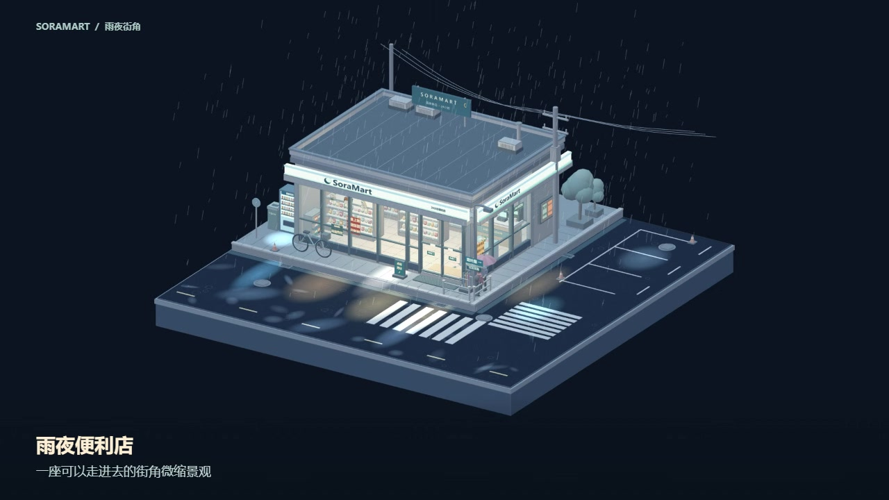
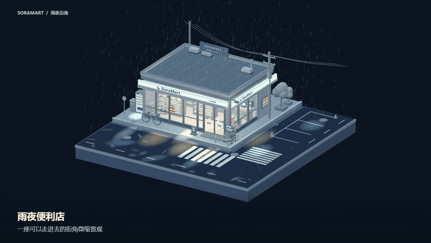
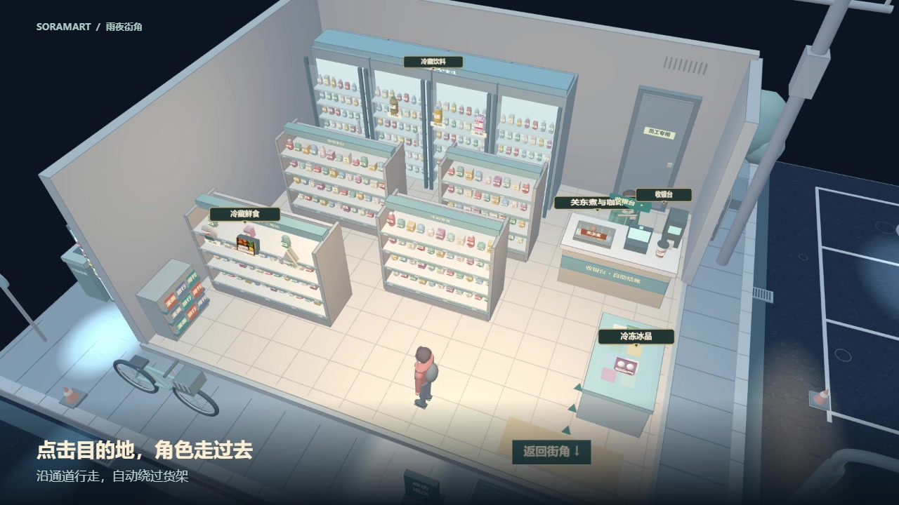
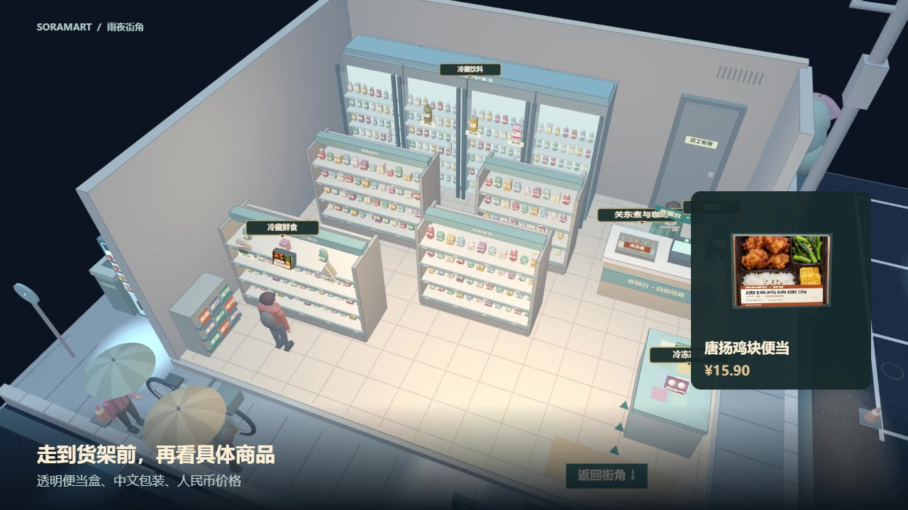
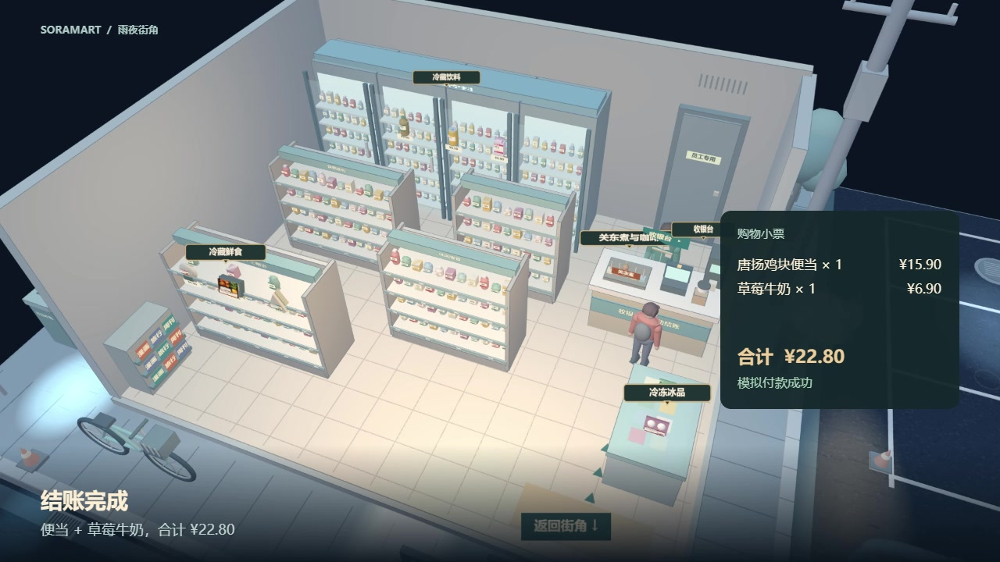

<div align="center">

# 雨夜便利店 · SoraMart

雨落街角，便利店还亮着灯。

一座可以旋转观察、走进店里、挑选商品的微缩三维场景。

[观看完整视频](media/SoraMart-showcase.mp4) · [快速开始](#快速开始) · [在线场景](https://ame-mart-rain-corner.sunnybrioche.chatgpt.site/)

<a href="media/SoraMart-showcase.mp4">
  
</a>

</div>

## 从街角，到店里

<div align="center">

<a href="media/SoraMart-showcase.mp4">
  
</a>

**15 秒自动轮播 · 点击画面观看完整视频**

街角全景 → 走进店里 → 挑选商品 → 收银结账

[完整展示 · 72 秒 · MP4 · 约 1.8 MB](media/SoraMart-showcase.mp4)

</div>

## 场景里的片刻

<table>
  <tr>
    <td width="50%" align="center">
      <br>
      <strong>在雨夜街角停一会儿</strong><br>
      <sub>玻璃橱窗、撑伞行人、积水倒影与路灯。</sub>
    </td>
    <td width="50%" align="center">
      <br>
      <strong>点哪里，就走向哪里</strong><br>
      <sub>角色沿通道行走，绕过货架，到达目的地。</sub>
    </td>
  </tr>
  <tr>
    <td width="50%" align="center">
      <br>
      <strong>挑一份今晚的便当</strong><br>
      <sub>近看包装、旋转商品，放进购物篮或放回货架。</sub>
    </td>
    <td width="50%" align="center">
      <br>
      <strong>结账，再走回雨里</strong><br>
      <sub>查看购物清单与合计，完成模拟付款后离店。</sub>
    </td>
  </tr>
</table>

## 快速开始

1. 在店外拖拽旋转场景，滚轮或双指缩放，点击门边的「进店」立牌。
2. 进入后点击地面，或直接点击商品、货区标识，让角色走过去。
3. 到达货架前查看商品，选择放入购物篮或放回。
4. 点击收银台，抵达后模拟付款，点击「带走购物袋」离店。

<details>
<summary><strong>在本地运行</strong></summary>

下载仓库，安装 Python，在仓库目录运行

```sh
python -m http.server 8000 --directory dist
```

在浏览器中打开 [http://localhost:8000/](http://localhost:8000/)。

所有脚本和素材均已包含在仓库中，可以直接启动。支持 WebGL 的现代桌面或移动浏览器均可体验。

</details>

<details>
<summary><strong>项目文件与素材说明</strong></summary>

| 位置 | 内容 |
| --- | --- |
| `dist/` | 完整场景、交互脚本与本地素材 |
| `media/scene-carousel.gif` | 适合 README 展示的自动轮播图 |
| `media/SoraMart-showcase.mp4` | 72 秒中文字幕展示视频，960 × 540 |
| `media/*.jpg` | 从实际场景录制中截取的展示图片 |

基于 Three.js 0.147.0 和 OrbitControls。第三方许可见 [THREE-LICENSE.txt](dist/THREE-LICENSE.txt)。

食品图为 AI 生成的包装展示贴图。商品采用人民币参考价，部分鲜食价格参考成都 7-Eleven 公开商品页。结账为场景交互。展示视频使用自动操作录制。

导出自已发布版本，原始版本提交为 `cbe37a3616939e0f9d5870d11c0c47ae44c12d4a`。在线场景的访问范围由托管端控制。

</details>
