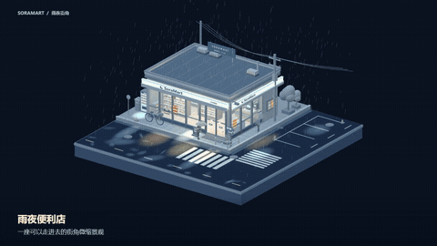

# 雨夜便利店 · SoraMart

雨夜街角的微缩三维便利店。可以旋转、缩放观察，也可以让角色走进店里，在货架之间行走、选购商品并模拟结账。

[](media/SoraMart-showcase.mp4)

[在线体验](https://ame-mart-rain-corner.sunnybrioche.chatgpt.site/) · [完整展示视频 · 72 秒 · 约 1.8 MB](media/SoraMart-showcase.mp4)

## 本地运行

安装 Python 后，在仓库目录运行

```sh
python -m http.server 8000 --directory dist
```

打开 http://localhost:8000/ 。

## 操作

- 拖拽街角模型旋转，滚轮或双指缩放。
- 点击门边「进店」立牌，角色会穿过自动门。
- 店内点击地面行走，点击商品、货区标识或收银台后，角色会自动绕过货架走过去。
- 到达商品前可旋转查看，放入购物篮或放回货架。
- 点击收银台，抵达后进行模拟付款。
- 点击「带走购物袋」或「回到街角」，角色会走到出口。

## 文件

- `dist/` 包含当前可运行的完整版本，所有素材均在仓库内。
- `media/SoraMart-showcase.mp4` 为带中文字幕的展示录屏，960 × 540，约 1.8 MB。
- `media/showcase-preview.gif` 为可在 README 中直接播放的精简动图。
- `media/preview.jpg` 为实际场景预览。

Three.js 0.147.0 及 OrbitControls 已包含在项目中，无需安装前端依赖或构建。第三方许可见 `dist/THREE-LICENSE.txt`。

## 版本与素材

导出自当前已发布版本，原始版本提交为 `cbe37a3616939e0f9d5870d11c0c47ae44c12d4a`。

食品图为 AI 生成的包装展示贴图。场景采用人民币参考价，部分鲜食价格参考成都 7-Eleven 公开商品页。结账为场景交互。

展示视频为自动操作录制，包含街角全景、进店、点击行走、商品查看、选购、结账和离店。
